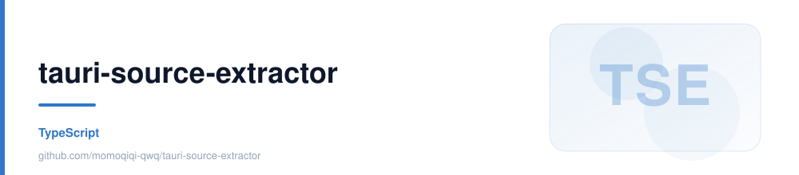

<div align="center">



**Tauri 关键源码提取器**

[](https://github.com/momoqiqi-qwq/tauri-source-extractor/stargazers)  

</div>

---

<details open>
<summary><b>目录</b></summary>

- [它解决什么问题](#它解决什么问题)
- [上下文预算（重要）](#上下文预算重要)
- [多项目](#多项目)
- [已加载文件夹管理页](#已加载文件夹管理页)
- [动效系统](#动效系统)
- [勾选的文件夹才会被加载](#勾选的文件夹才会被加载)
- [设置](#设置)
- [勾选会被记住](#勾选会被记住)
- [分类规则](#分类规则)
- [导出格式](#导出格式)
- [更新日志](#更新日志)
- [键盘快捷键](#键盘快捷键)
- [开发与构建](#开发与构建)
- [技术要点](#技术要点)
- [目录结构](#目录结构)
- [常见问题](#常见问题)

</details>

---

---

---

# Tauri 关键源码提取器

一个 Tauri v2 桌面应用：扫描任意 Tauri 项目，自动识别「关键源码」，勾选后导出**单个合并文件**（直接粘贴给 AI 当上下文），或**一键打包成 zip**（保留原始目录结构，文件字节不损）。

## 它解决什么问题

Tauri 项目结构分散（Rust 后端 + 前端 + 配置 + capabilities），手动挑文件喂给 AI 又慢又容易漏。这个工具：

1. **自动分类**——把文件归入 `Tauri 配置 / Rust 后端 / 前端源码 / 数据迁移 / 文档 / 环境变量 / 其他`
2. **默认只勾关键源码**——`node_modules`、`target`、`dist`、各种 lock 文件全部自动跳过
3. **一键合并**——输出带目录树 + 文件路径标注 + 语言高亮的单文件包，附 token 估算
4. **安全默认**——`.env*`、`*.key`、`credentials.json` 等凭据默认不勾选并标红 `SECRET`
5. **上下文预算**——实时预估 token 数并对比常见窗口，超了就变黄/变红提醒
6. **按需加载**——导入几十个文件夹时，只有你勾选启用的那几个才会被扫描和展开

## 上下文预算（重要）

导出包是**喂给 AI 当上下文**的，所以「装不装得下」比「全不全」更关键。

界面右栏会实时显示**预估上下文**，并按档位变色：

| 预估 token | 档位 | 提示 |
| --- | --- | --- |
| ≤ 128k | 绿 | 在 128k 舒适区内 |
| 128k – 256k | 黄 | 已超过 128k，偏大 |
| > 256k | 红 | 已超过 256k，多数模型放不下 |

超预算时会给出可操作的建议：**用左侧分类 chip 关掉不需要的类别**（每个 chip 上都标了
该类别的 token 体量，比如 `前端源码 146/146 ≈320k`），或**调低「单文件上限」**把大文件剔掉。

> 实测参考：`tiez-clipboard-master` 的默认勾选是 **220 文件 / 2.05 MB ≈ 596k tokens**
> ——约 4.7 倍于 128k 窗口、3.0 倍于 200k 窗口。也就是说**默认全勾是喂不进去的**，
> 一定要按预算裁剪。这是这个工具存在的意义之一。

## 多项目

一个文件夹 = 一个项目，可以同时导入任意多个：

- **+ 添加项目**：多选文件夹，每个都成为列表里独立的一张卡片
- **直接拖拽**：把文件夹（可多选）从资源管理器拖进窗口，松手即添加
- **自动识别子项目**：选一个父目录（比如 `E:\E-Develop-Project`），自动把下面所有含
  `src-tauri/`、`package.json` 或 `Cargo.toml` 的目录一次加进来
- 每张卡片可**单独展开 / 收起**，顶部还有「全部展开 / 全部收起」
- **只有勾了启用框的文件夹才会真的扫描**，未启用的只占列表里一行（见「勾选的文件夹才会被加载」）
- 每个项目有自己的勾选状态、分类统计、`↻` 重新扫描、`导出`（只导出本项目）
- 全局「生成提取包」会把所有**已启用**项目**合并成一个包**：目录树以项目名为顶层，
  文件标题带项目前缀，避免不同项目的同名文件混淆
- 项目列表（含哪些处于启用状态）存在 localStorage，下次打开自动恢复（勾选也会，见下节）

## 已加载文件夹管理页

顶栏有「**提取** / **已加载文件夹**」两个标签。前者用来挑文件，后者用来**统管项目**。

管理页是一张表，一屏看全所有导入的文件夹：

| 列 | 说明 |
| --- | --- |
| （多选） | 行首圆形多选钮，`Shift` 点选成段，表头全选；选中后底部浮出批量条 |
| 项目 | 启用勾选框 + 类型徽章（TAURI / NODE / RUST）+ 名称。未启用的行整行置灰、数字显示 `—` |
| 完整路径 | 等宽字体，过长省略，悬停看全 |
| 文件 | `已选 / 总数` |
| 行数 | 已选文件的总行数 |
| 预估 token | 按预算档位着色（绿 ≤128k / 黄 ≤256k / 红 >256k），悬停看档位说明 |
| 状态 | 就绪 / 扫描中 / 扫描失败（悬停看错误原因） |
| 操作 | 打开 · 仅关键 · 全不选 · 重扫 · 导出 · 移除 |

表头吸顶、合计行吸底；顶部有按名称/路径筛选，右上角是全局统计。

**所有列都可点表头排序**：升序 → 降序 → 回到导入顺序（三态循环）。
最常用的是点「预估 token」降序——**直接找出最占地方的那个**。
「状态」列排序时**异常优先**（扫描失败 → 扫描中 → 就绪），有问题的一眼可见。

**为什么要单独一页**：同时导入多个文件夹时，需要**横向对比「谁最占 token」**再决定裁哪个。
卡片视图是纵向堆叠的，对比起来要来回滚动；表格能一眼扫完，且「预估 token」直接着色，
超预算的文件夹立刻跳出来。

「打开」会切回提取页并展开该文件夹，两个视图是连贯的。

## 动效系统

按键交互与界面弹出全部收敛在一套三层结构里，改任何动效都从这套系统取值，不再各写各的：

1. **Token 层** —— `styles.css` 顶部的 `--dur-fast / --dur-base / --dur-slow / --dur-exit`
   与 `--ease-out / --ease-in / --ease-spring` 是全站唯一的时长与缓动来源
2. **生命周期层** —— `src/motion.ts` 的 `usePresence` 统一弹层（toast / 错误横幅）的
   「进 → 停 → 出」：先播进场动画，停留，关闭时先加 `.is-leaving` 播退场动画，播完才真正卸载
3. **模式层** —— 一组 `tse-*` keyframes 绑定在组件类名上，谁挂载谁播放

覆盖范围：

| 交互 | 动效 |
| --- | --- |
| 所有按钮 / tab / 分类 chip | 悬停上浮、按压下沉、键盘焦点环（`:focus-visible`）、忙碌 spinner |
| toast | 底部弹入，2.4s 后自动退场；连续弹会重置计时器（旧实现会被上一条的定时器提前清掉） |
| 错误横幅 | 顶部滑入，点 × 播退场动画后消失 |
| 视图切换（提取 / 管理） | 整体淡入（main 按 view 重挂载） |
| 项目卡片 | 列表错峰上浮（nth-child 延迟，封顶 280ms）；展开时内容体上升、文件树淡入 |
| 管理页表格 | 行按 `--i` 顺序淡入（`min()` 封顶 240ms），排序 / 筛选后重建的行同样适用 |
| 预算档位切换 | 数值行弹入动画重播，颜色随档位平滑过渡 |
| 扫描中 | 状态文案呼吸提示 |

系统尊重操作系统的「减少动态效果」设置：`prefers-reduced-motion: reduce` 下所有动画与
过渡即时完成，界面功能不受影响。

> JS 侧只需要知道一个数值：`MOTION.exit`（退场动画时长，决定何时卸载）。改 CSS 的
> `--dur-exit` 时要同步 `motion.ts`，反之亦然。弹层**停留多久**不再是写死的常量，
> 而是用户可改的偏好，住在 `DEFAULT_SETTINGS` 的 `toastTtl` / `errorTtl`（见「设置」一节）。

### 改 UI 时怎么预览

```bash
npm run preview:design                       # 产物在 design-preview/
npx vite preview --outDir design-preview     # 用浏览器打开它报出的 http://localhost:xxxx
```

> 产物**不能直接双击用 `file://` 打开**：ES module 在 `file:` 下被当作唯一源，
> 会被 CORS 拦掉（页面空白，控制台才是真相）。必须经 HTTP。

渲染的是**真实的组件 + 真实的 styles.css + 真实的 `selection.ts` 纯逻辑**，
只把 Tauri 文件系统层换成内存 mock —— 不是手抄的静态 HTML
（那种会随实现漂移，给出错误印象）。`preview/` 与产品构建隔离，不影响 `dist/` 和打包。

它是**可交互的迷你版应用**，不是截图：

- 顶栏可在「提取 / 已加载文件夹」两个视图间切换
- 批量选择（全选 / 全不选 / 仅关键 / 反选）、点分类 chip、展开收起文件树，都真的生效
- 管理页可点表头排序、在筛选框里打字、点「移除」删行、点「+ 添加项目」加行
- 「重扫」会真的走一遍 `扫描中… → 就绪`，用来检查状态样式
- 启用勾选框、行首多选圆点 + Shift 成段选 + 批量条、拖拽侧边栏宽度、设置面板改数值，
  全都是真状态真生效 —— 上面这些交互就是在这个 harness 里点着验的

好处是交互对不对可以**直接上手试**，不必靠文字描述互相想象，也不必启动 Tauri。
动效与真实应用完全一致（同一份 `styles.css` token 与类名约定），进场、退场、错峰都能直接看到。

mock 数据刻意覆盖三档预算颜色，以及就绪 / 扫描中 / 失败 / 未启用四种状态，让所有样式分支都能被看到。

## 勾选的文件夹才会被加载

一次导入几十个文件夹是常态（`自动识别子项目` 一下就是一屏）。全部自动扫描、全部展开文件树，
代价是**上万行 DOM 挂在页面上**，界面直接卡死。所以「加进列表」和「真的加载」被拆成两步：

- 每个项目行首一个**启用勾选框**：勾上才扫描、才渲染文件树、才进统计与导出
- 未启用的行只占一行（置灰、数字显示 `—`、状态 `未启用`），点一下就能启用
- 一次添加**超过「自动加载上限」个**文件夹时默认全部不启用，等你自己挑；这个阈值可在设置里改
- 停用不丢数据：扫描结果留在内存里，再勾上立刻就有树，不必重扫

多选是**另一件事**，用行首的圆形按钮（hover 才现身，与方形的启用框在形状上区分开）：
选中若干行后底部浮出批量条，可批量启用 / 停用 / 反选 / **一键移除**。管理页表格支持
`Shift` 点选成段，表头有全选框。移除只删列表项与它的勾选存档，**不碰磁盘上的任何文件**，
默认还需要点第二次确认（可在设置里关掉）。

> 这里有个容易踩的坑：勾选存档按「还活着的根目录」清理。若把未启用的项目从传给
> `nextSelMap` 的列表里过滤掉，它们的存档会被当成"已删除"一起清掉。
> 这条不变量由 `npm run verify:sel` 锁住。

## 设置

顶栏 ⚙（或 `Ctrl + ,`）呼出。放的是原先**写死在代码里的时长与阈值**，改完即时生效并自动保存：

| 组 | 项 | 默认 |
| --- | --- | --- |
| 提醒 | 提示停留时长（0 = 不自动关闭）、错误横幅停留时长 | 2400ms / 常驻 |
| 加载行为 | 自动加载上限、启用后自动展开、文件树折叠阈值 | 5 / 开 / 250 个 |
| 导出与预览 | 自动重生成、重生成防抖、预览截断字符数 | 开 / 700ms / 200000 |
| 界面 | 左侧面板宽度、批量移除二次确认 | 470px / 开 |

导出格式、目录树、统计、单文件上限**不在这里** —— 右侧选项栏已经是它们的唯一入口，
两处入口必然漂移。

设置与 `ExtractOptions` 是两个类型：后者是 `extract_bundle` 的 IPC 契约，会整个序列化给
Rust，把「toast 停留多久」塞进去等于往协议里加后端从不读的字段。

侧边栏宽度也可以**直接拖**中间的分隔条：钳制在 320px 与窗口宽度之间，双击复位，
点住后可用 `←/→` 微调（`Shift` 加大步长）。拖动过程中宽度不走 React state，
而是直接改写 CSS 变量，松手才提交一次 —— 否则每移动一像素就重渲染整棵项目树。

## 勾选会被记住

既然默认全勾**一定超预算**（见上节），每次都要手动裁剪；那裁剪结果当然不能被一次重启清空。

工具会把你的勾选按项目**持久化**，下次打开同一个项目时自动还原。存储用的是**增量**而不是全量：

- 只记 `off`（本来默认勾选、被你取消的）和 `on`（本来不勾、被你选上的）
- 默认值由扫描结果重新算得出来，不必存
- 实测默认 220 个文件的项目，存全量要 220 条路径，存增量通常只有个位数到几十条

同一套增量逻辑也用于**会话内重扫**（卡片上的 `↻`）：

- 保留你仍然存在的勾选
- 自动补上这次新出现的关键文件
- 已被删除的文件从勾选里剔除

> 这段逻辑前端没有测试框架兜着，而它出错是**静默**的（不报错，只是少勾/多勾），
> 所以单独抽到 `src/selection.ts` 并配了往返校验：`npm run verify:sel`。
> 校验脚本直接 import 真实实现，不复制逻辑，避免脚本与实现悄悄漂移。

## 分类规则

设计取向是**宁可多选，不可漏选**。

| 分类 | 命中规则 | 默认勾选 |
| --- | --- | --- |
| Tauri 配置 | `tauri.conf*.json`、`tauri.*.conf.json`、`capabilities/**`、`permissions/**`、`src-tauri/Cargo.toml`、`build.rs` | ✅ |
| Rust 后端 | 所有 `*.rs`、任意层级的 `Cargo.toml`、`rust-toolchain*` | ✅ |
| 前端源码 | `src/**` `app/**` `pages/**` `components/**` `hooks/**` `styles/**` 等，`*.ts/tsx/js/jsx/vue/svelte/css/scss/html`，`package.json`、`vite.config.*`、`tsconfig*`、`tailwind.config.*` 等 | ✅ |
| 数据/迁移 | `*.sql`、路径含 `migration` | ✅ |
| 配置文件 | 其余 `*.json/toml/yaml/yml/xml/ini/plist/graphql/proto/csv`，以及打包脚本 `*.nsh/nsi/wxs/iss/sh/ps1/bat/py` 等 | ✅ |
| 文档 | `*.md/mdx/txt/rst`、`README*`、`LICENSE*`、`CHANGELOG*` | ⬜（**根目录 README 例外，默认勾选**） |
| 环境变量 | `.env*` | ⬜（标 SECRET） |
| 其他 | 其余文本文件 | ⬜ |

「配置文件」这一类是专门为了不漏文件而加的：像 `config.json`、`docker-compose.yml`、
`.github/workflows/*.yml`、`Info.plist`、NSIS 的 `installer.nsh` 这些以前会掉进「其他」被漏掉，现在默认勾选。

「文档」类整体默认不勾选（避免把 `LICENSE`、图片说明等噪音塞进上下文），但**项目根目录的
`README*` 是例外**——它对理解项目整体最有价值，默认勾选。

### 凭据文件会被标记 SECRET 且不默认勾选

导出包通常要贴进 AI 对话，所以明显是凭据的文件不会被自动带上（仍可手动勾选）：

- **后缀**：`*.pem` `*.key` `*.p12` `*.pfx` `*.jks` `*.keystore` `*.ppk` `*.asc` `*.tfvars` `*.tfstate`
- **文件名**：`.env*`、`.npmrc`、`.netrc`、`.pgpass`、`.htpasswd`、`.envrc`、
  `id_rsa`/`id_dsa`/`id_ecdsa`/`id_ed25519`、
  `credentials.json`、`secrets.json|yaml|yml`、`service-account.json`、`google-services.json`

> 判定用的是**精确文件名 + 后缀**，不是 `secret` 这种前缀 —— 否则 `src-tauri/src/secrets.rs`
> 这类「名字里带 secret 的源码」会被误判，反而漏掉关键源码。这条有专门的回归测试守着。

**自动跳过的目录**：`node_modules` `target` `dist` `build` `out` `.next` `.nuxt` `.git`
`.vite` `coverage` `vendor` `pods` `.venv` 等。
**自动跳过的文件**：各类 lock 文件（`Cargo.lock`、`package-lock.json`…）、`*.tmp`、`*.bak`。

> **`gen` 是按作用域跳过的**：只在 `src-tauri/gen/**`（Tauri 生成 capability schema 的位置）
> 生效。根目录或别处的 `gen/` 是常见真实源码目录（Android、protobuf/gRPC 代码生成），
> 会被正常收录——早期版本按目录名全局跳过，会**无声漏掉**这些源码。

## 导出格式

- **Markdown**（推荐）——目录树 + 每个文件一个带语言标注的代码块，适合直接粘贴给大模型
- **XML**——类 repomix 的 `<file path="...">` + CDATA 结构，适合程序化解析
- **纯文本**——`=====` 分隔符，兼容性最好
- **ZIP 压缩包**——操作栏「**打包关键源码 (zip)**」，把当前勾选的文件按原始目录结构直接压缩，见下节

可选开启「自定义提示词」，在包最前面插入一段角色说明 / 任务描述。

### 一键打包 zip

「打包关键源码 (zip)」**不走合并格式**，直接读文件本体写进压缩包：

- 单项目：zip 内就是项目相对路径，解压即得项目结构
- 多项目：顶层目录为项目名（非法字符会被替换成 `_`），不同项目的同名文件不会互相覆盖
- 文件**字节不损**（含二进制），这是合并文本导出做不到的
- 包内第一个条目是 `BUNDLE-INFO.txt` 清单：包含哪些项目、各多少文件、生成时间、跳过了什么及原因
- 读取失败 / 文件缺失会逐条列入「跳过」，不会静默丢文件；`../` 这类危险相对路径会被拦下
- zip 内文件名用 UTF-8，文件时间戳为打包时的 UTC 时间

## 更新日志

### v0.5.0 自己拿主意：按需加载、批量管理、可配置

- **勾选才加载**：项目行首的启用框决定谁真的扫描、展开文件树、进统计与导出；
  一次导入几十个文件夹不再自动挂出上万行 DOM
- **多选 + 一键移除**：行首圆形多选钮（管理页支持 `Shift` 成段选、表头全选），
  底部批量条可批量启用 / 停用 / 反选 / 移除；移除只删列表与存档，不碰磁盘
- **侧边栏可拖拽调宽**：分隔条拖动 / 双击复位 / `←/→` 微调，宽度持久化
- **设置面板**（顶栏 ⚙ 或 `Ctrl + ,`）：提示与错误停留时长、自动加载上限、
  文件树折叠阈值、自动重生成开关与防抖、预览截断字符数、面板宽度、批量移除是否二次确认
- 存档读写新增往返校验 `npm run verify:persist`：坏字段不再被 `Number()` 悄悄变成 0，
  老 `roots.v2` 存档可迁移，localStorage 不可用时静默降级

### v0.4.0 舒适：暗色主题

- 全套颜色 token 化：组件规则不再写死颜色，暗色只需覆盖一层 token
- 顶栏 ◐ 按钮循环切换 **跟随系统 → 亮色 → 暗色**，选择持久化；「跟随系统」下监听系统切换实时变更
- 分类 chip、徽章、预算档位色、警示条、滚动条在暗色下逐一调过对比度

### v0.3.0 明：反馈与结果

- zip 打包完成的 toast 带「**打开文件夹**」按钮，一键在资源管理器里显示产物（opener 插件）
- 快捷键速查浮层：随时按 `?`（或点顶栏 ⌨）呼出，`Esc` / 点遮罩关闭
- 导出文件名自动带日期（`demo-key-source-20260914.zip`），方便按日期归档

### v0.2.0 快：操作效率

- **拖拽文件夹进窗口 = 添加项目**，支持一次拖多个，全窗遮罩提示
- 全局键盘快捷键（见下节）
- 管理页「**全部重扫**」一键刷新所有文件夹
- 记住窗口大小 / 位置 / 最大化状态，下次打开原样恢复（window-state 插件）

## 键盘快捷键

| 按键 | 作用 |
| --- | --- |
| `Ctrl + Enter` | 生成提取包 |
| `Ctrl + S` | 保存文件 |
| `Ctrl + Shift + C` | 复制提取包 |
| `Ctrl + F` 或 `/` | 聚焦搜索框（在管理页会先切回提取视图） |
| `Ctrl + 1` / `Ctrl + 2` | 切换 提取 / 已加载文件夹 |
| `Ctrl + ,` | 打开设置 |
| `?` | 快捷键速查浮层 |
| `Esc` | 关闭弹层（设置 / 速查表） |

单键快捷键（`/`、`?`）在输入框打字时不会触发；`Ctrl` 组合键随时可用。

## 开发与构建

前置要求：Rust 工具链（`cargo`）、Node.js 18+、Windows 上需 WebView2（Win11 自带）、
Visual Studio 的「使用 C++ 的桌面开发」工作负载。

```bash
# 安装依赖
npm install

# 开发模式（热更新）
npm run tauri dev

# 打包（产出 exe + NSIS 安装包）
npm run tauri build
```

### ⚠️ 在 Git Bash 里构建必须走这个脚本

Git Bash 的 `PATH` 里有 `/usr/bin`，其中的 **GNU coreutils `link.exe` 会遮蔽 MSVC 的链接器**，
直接跑 `cargo build` / `npm run tauri build` 会报：

```
error: linking with `link.exe` failed
note: `link.exe` returned an unexpected error
note: you may need to install Visual Studio build tools with the "C++ build tools" workload
```

（这句提示是误导，VS 其实装好了。）用附带脚本自动注入 MSVC 环境即可：

```bash
bash scripts/msvc-env.sh cargo test          # 跑单元测试
bash scripts/msvc-env.sh npm run tauri build # 打包
bash scripts/msvc-env.sh                     # 只打印检测到的工具链路径
```

在 **PowerShell / CMD / VS 开发者命令提示符**里则不需要，直接 `npm run tauri build` 即可。

### 构建产物

```
src-tauri/target/release/tauri-source-extractor.exe                              # 免安装单文件
src-tauri/target/release/bundle/nsis/Tauri Source Extractor_0.5.0_x64-setup.exe  # NSIS 安装包
```

### 测试与校验

```bash
# 后端单元 + 端到端测试（32 项）
bash scripts/msvc-env.sh cargo test --lib

# 前端校验：IPC 命令名一致性 + 勾选增量往返（45 项）+ 存档读写往返（18 项）
# + 组件渲染冒烟（35 项）
npm run verify
```

覆盖分类规则、行数统计、二进制嗅探、目录树渲染、语言映射、token 估算、时间格式化，
以及下面四类**静默失败**（不报错、只是结果不对）：

| 校验 | 防的是什么 |
| --- | --- |
| `verify:ipc` | 前端 `invoke("...")` 的名字与后端 `generate_handler![...]` 不一致 —— tsc 能过、构建能过，只有点下去才报 `command not found` |
| `verify:sel` | 勾选增量存/取的往返有损 —— 不报错，只是重启后少勾/多勾；以及未启用项目的存档被误清、多选区间算错 |
| `verify:persist` | 存档坏字段被 `Number()` 悄悄转成 0（`toastTtl` 变 0 = 弹层再也不消失）、老存档迁移丢启用状态、localStorage 不可用时直接崩 |
| `verify:render` | 组件在真实渲染路径上抛异常（未定义的 props、空数组取下标）—— `vite build` 能过，只有打开界面才白屏 |

> `verify:sel` / `verify:persist` 直接 `import ../src/*.ts`（真实实现），不复制逻辑，
> 避免脚本与实现悄悄漂移后给出虚假的通过。也因此这几个模块的**值导入**必须写全
> `.ts` 后缀（Node 的 ESM 解析器不像 Vite 会补扩展名；纯类型导入会被擦除，不用写）。

`verify:render` 用 `react-dom/server` 把真实组件渲染成 HTML，**不需要浏览器**，
因此在命令行 / CI 里就能跑。断言分两类，不能混：

- **文本断言**先剥掉 HTML 注释与标签 —— React 会把 `{a}/{b}` 渲染成 `<b>220</b>/294`，
  直接找 `"220/294"` 会假失败
- **类名/属性断言**（如 `title="..."`、`project-tree`）必须用原始 HTML，
  剥了标签就永远找不到，会**假通过**

> 这几个脚本都做过**负向测试**：故意改坏实现，确认脚本真的会红。
> 一个从不失败的校验脚本等于没有校验。

## 技术要点

- **扫描在 Rust 侧完成**，直接用 `std::fs` 读文件，不受 Tauri fs 插件 scope 限制，可读取任意目录
- 桌面体验靠三个官方插件：`dialog`（选文件夹/保存）、`window-state`（记住窗口）、`opener`（在资源管理器中显示产物）
- 拖拽导入走 webview 原生 drag-drop 事件（`getCurrentWebview().onDragDropEvent`），不依赖 HTML5 拖放
- 暗色主题：颜色全部收敛在 CSS token 层，`html[data-theme]` 一个属性整体切换；「跟随系统」由 JS 监听 `matchMedia` 换算
- 未知后缀的文件用「前 4KB 是否含 NUL 字节」嗅探，自动区分文本/二进制
- 文件树按目录聚合，目录节点支持三态勾选（全选/半选/未选）
- 预览超过 20 万字符自动截断，避免大项目卡顿
- token 估算按 `字符数 / 3.6` 粗略计算（代码以 ASCII 为主）
- 上下文预算实时显示，按 128k / 256k 分档变色

## 目录结构

```
src/                        前端（React + TS）
  App.tsx                   主界面编排：项目列表、选项、预算、导出
  api.ts                    invoke / dialog 封装
  types.ts                  与 Rust 结构体对应的类型 + 界面偏好（UiSettings）+ 预算/格式化工具
  selection.ts              勾选纯逻辑（默认值、增量、重扫合并、批量/分类操作、存档解析与合并、多选集合运算）
  stats.ts                  选中统计纯函数（顶栏总计 / 卡片 / 管理页共用一套口径）
  persistence.ts            localStorage 读写（项目列表 + 启用状态 / 选项 / 勾选增量 / 主题 / 界面偏好）
  motion.ts                 动效系统 JS 侧：弹层「进→停→出」生命周期（usePresence）
  components/Topbar.tsx        顶栏（品牌、视图切换、主题、设置入口、全局动作）
  components/ShortcutsModal.tsx 快捷键速查浮层（? 呼出）
  components/SettingsModal.tsx  设置面板（Ctrl + , 呼出，提醒/加载/导出/界面四组偏好）
  components/FileTree.tsx      文件树（三态勾选、搜索、大项目默认折叠）
  components/ProjectCard.tsx   单个项目卡片（启用勾选、多选、展开/收起、分类勾选、单独导出）
  components/ProjectManager.tsx 已加载文件夹管理页（表格 + 横向对比 + 启用列 + Shift 多选）
  components/PanelResizer.tsx  侧边栏拖拽手柄（拖动期直写 CSS 变量，松手才提交）
  components/BulkBar.tsx       多选后的批量操作条（启用/停用/反选/二次确认移除）
preview/                    设计预览 harness（真实组件 + mock 数据，可交互）
  main.tsx                  迷你版应用：视图切换 + 真实交互处理
  mocks.ts                  共享 mock 数据（覆盖三档预算 + 就绪/扫描中/失败/未启用四种状态）
src-tauri/src/
  lib.rs                    命令注册 + 端到端测试 + 真实项目体检
  scanner.rs                扫描 + 分类 + 文本嗅探 + 子项目自动发现
  extractor.rs              多项目合并导出（markdown/xml/plain）+ 目录树 + token 估算
  zipper.rs                 zip 打包导出（保留目录结构、BUNDLE-INFO 清单、路径防护）
  timefmt.rs                零依赖时间工具（生成时间字符串、zip 条目时间戳）
scripts/make_icon.py        纯标准库生成源图标（无 PIL 依赖）
scripts/msvc-env.sh         Git Bash 下注入 MSVC 构建环境（见上文「构建」）
scripts/verify-ipc.mjs      IPC 命令名一致性校验
scripts/verify-sel-delta.ts 勾选增量与多选集合往返校验（直接 import 真实实现）
scripts/verify-persistence.ts 存档读写往返校验（stub localStorage）
scripts/smoke-render.tsx    组件渲染冒烟测试（react-dom/server）
scripts/run-render-smoke.mjs 用 esbuild 打包上面的 .tsx 再交给 node 跑
```

## 常见问题

**「生成提取包」按钮是灰的？**
两种可能：① 一个项目都没启用 —— 未启用的文件夹不参与导出，勾上它行首的方框；
② 启用了但勾选数为 0 —— 展开左侧项目，点工具条上的「仅关键」即可一键勾选所有关键源码。

**扫不到文件？**
确认选的是**项目根目录**（含 `src-tauri/` 或 `package.json` 的那一层），不是它的父目录。
父目录请用「自动识别子项目」。
